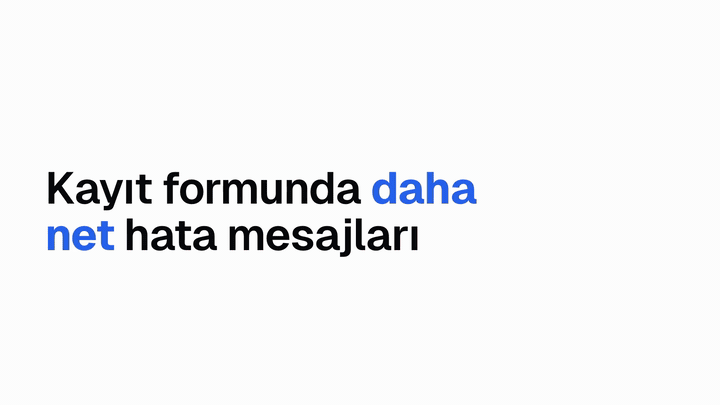
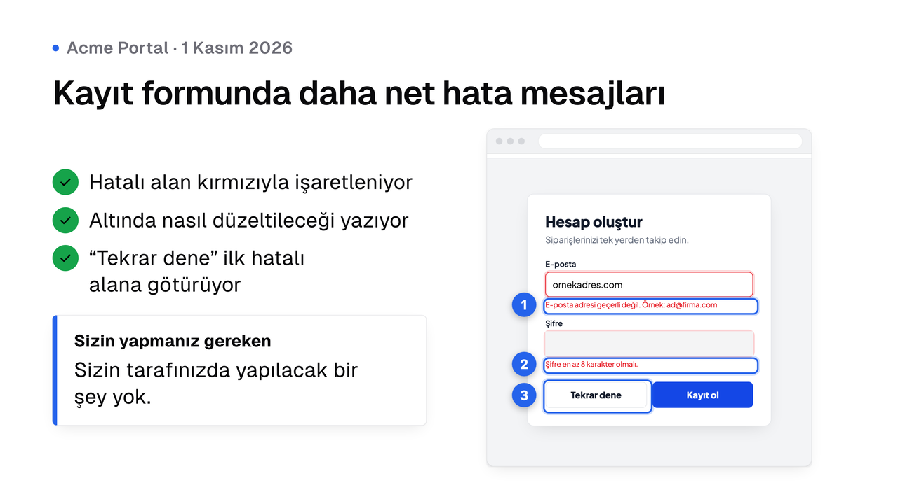
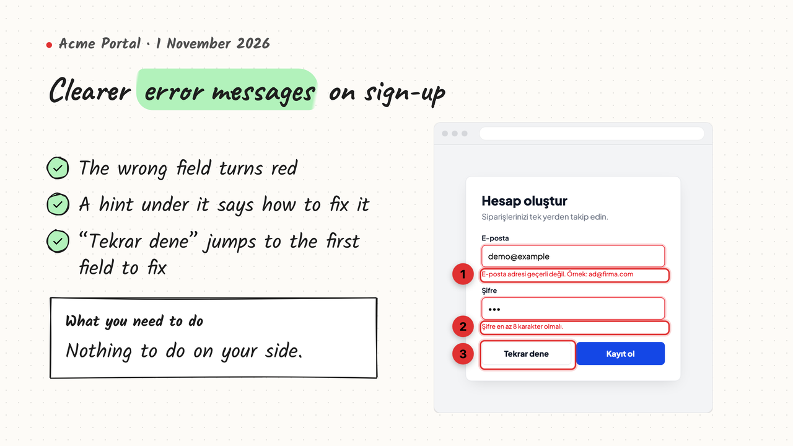
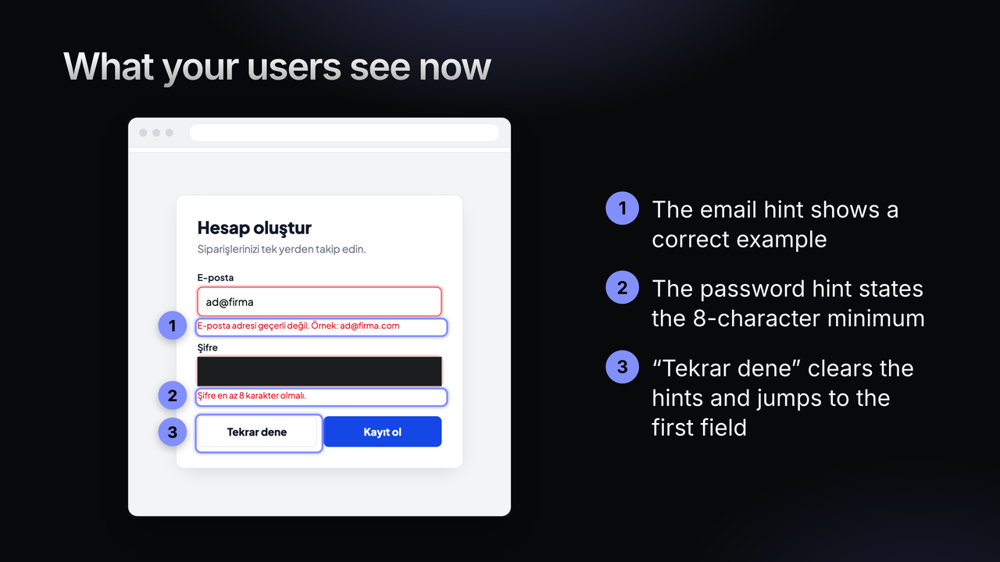
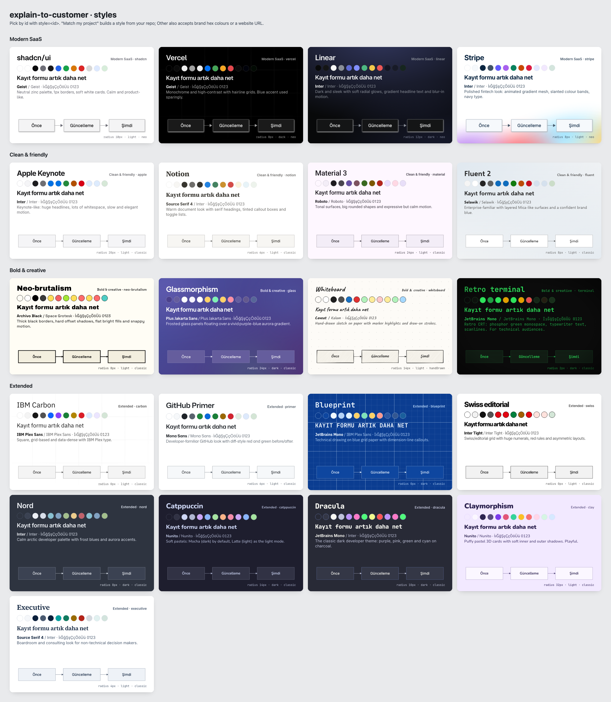

<p align="center" class="logo-section">

<br/>


<p align="center">
A Claude Code skill that turns a code change into a short video, slides and diagrams you can send to a client.<br>
<br/>
<br/>

</p>
<p align="center">
<a align="center" href="#usage">Documentation</a>
  </p>
</p>

<p align="center">

</p>

<p align="center">

</p>

You finish a change, run `/explain-to-customer`, answer four quick questions and get a folder you can send to the client:

- a 30–60 s MP4 with burned-in captions (1920×1080, H.264, small enough for email), plus a poster image and a GIF preview
- 3–5 PNG slides, including a one-page summary card that works on its own in WhatsApp or email
- Mermaid diagrams as SVG and PNG, with the editable `.mmd` source
- a short message in the customer's language, ready to paste

The skill reads the diff and the code around it, quotes the product's real UI strings, and can take screenshots of your running app. Those screenshots get numbered callouts and masked personal data, and the "before" shot comes from a temporary git worktree. Every frame, slide and diagram goes through a QA pass before anything is handed over. Your project is only read: nothing in it is edited, committed, stashed or installed.

| shadcn | Whiteboard | Linear |
|---|---|---|
|  |  |  |

### Styles

21 styles inspired by public design languages, plus **Match my project**, which builds a style from your repo's own colours, fonts, radius and logo (shadcn/Tailwind CSS variables, `tailwind.config`, MUI/Chakra/Mantine themes, design tokens, `next/font`). You can also pass brand hex colours or a website URL.

<p align="center">

</p>

| Family | Styles |
|---|---|
| Modern SaaS | `shadcn` · `vercel` · `linear` · `stripe` |
| Clean & friendly | `apple` · `notion` · `material` · `fluent` |
| Bold & creative | `neo-brutalism` · `glass` · `whiteboard` · `terminal` |
| Extended | `carbon` · `primer` · `blueprint` · `swiss` · `nord` · `catppuccin` · `dracula` · `clay` · `executive` |

Every style is checked for WCAG AA contrast before rendering, and uses open fonts only, bundled locally with the subsets your language needs.

<p align="center">

</p>

Requirements: [Claude Code](https://github.com/anthropics/claude-code), Node.js 22 or newer (older versions fall back to a slower video engine), FFmpeg and git. The GitHub CLI is optional, for `PR#123` scopes.

```bash
# macOS / Linux
git clone https://github.com/halitsever/explain-to-customer-skill ~/.claude/skills/explain-to-customer

# Windows (PowerShell)
git clone https://github.com/halitsever/explain-to-customer-skill "$env:USERPROFILE\.claude\skills\explain-to-customer"
```

If `~/.claude/skills` did not exist before, run `/reload-skills` once in Claude Code.

FFmpeg: `brew install ffmpeg`, `winget install Gyan.FFmpeg` or `sudo apt install ffmpeg`. Without admin rights the skill can install a static build for you.

The first run asks to install the rendering toolchain once, about 250 MB of downloads: npm packages (~151 MB) and a headless Chromium (~99 MB, skipped when Playwright already has it). Everything goes into `~/.cache/explain-to-customer` (`%LOCALAPPDATA%\explain-to-customer` on Windows), never into your project.

To update: `git -C ~/.claude/skills/explain-to-customer pull`.

## Usage

```
/explain-to-customer
/explain-to-customer HEAD~3..HEAD video style=apple out=desktop
/explain-to-customer PR#42 all lang=en --yes
/explain-to-customer "Invoices are now emailed automatically" diagram style=executive
/explain-to-customer image style=#E11D48,#0EA5E9
```

Without arguments the skill works out the scope itself: everything since your feature branch left the default branch, or your uncommitted changes, or the last commit. It recommends a format, then asks what to create, where to save it, which style to use and whether to take screenshots. Before rendering it shows the storyboard for approval.

| Argument | Meaning |
|---|---|
| `a1b2c3d`, `main..HEAD`, `PR#42`, `"text"` | What changed |
| `video` · `image` · `diagram` · `all` | What to create |
| `style=` | A style id or name, `match`, brand hex colours or a website URL |
| `out=` | `project` (default), `cwd`, `desktop`, `videos` or a path |
| `lang=` | Language of everything the customer sees; defaults to the language you write in |
| `audience=technical` | Allows technical terms and code-level diagrams |
| `--yes` | Skip the approval step |

Output, for example in `customer-explainers/2026-11-01-clearer-sign-up-errors/`:

```
clearer-sign-up-errors.mp4    -poster.png    -preview.gif
images/01-summary.png  02-….png
diagrams/<name>.svg  <name>.png
message.md
_source/   storyboard, scenes, .mmd files, tokens, QA report (for cheap re-renders)
```

Tweaks after delivery are cheap: ask for a shorter cut, another language or another style, and only the affected outputs are rendered again.

### How it works

1. `preflight.mjs` collects OS, git scope, save locations, a running dev server and tool status as JSON.
2. Claude reads the diff, writes a change brief and a storyboard, and asks for approval.
3. `theme.mjs` turns the style into CSS variables, a Mermaid config and a local font bundle, fixing contrast where needed.
4. `capture.mjs` screenshots the app with Playwright. `render-diagrams.mjs`, `render-stills.mjs` and `render-video.mjs` render the outputs. Video is a [HyperFrames](https://github.com/heygen-com/hyperframes) composition with GSAP, rendered locally in headless Chrome and FFmpeg.
5. `qa.mjs` checks codecs and sizes, extracts frames, flags blank frames, missing glyphs, placeholders, secrets and jargon, and Claude looks at every frame before delivering.

### Privacy and honesty

- Secrets, internal URLs, stack traces and real customer data never go on screen; screenshots use demo data and mask emails, phone numbers, tokens and password fields.
- Nothing is invented: no made-up features, numbers or dates, and visuals that are not real screenshots stay clearly illustrative.
- Rendering is local. No cloud rendering, publishing or telemetry.

### Development

```bash
node --test scripts/test/paths.test.mjs   # save-path resolution on macOS, Windows, Linux and WSL
node scripts/theme.mjs --validate         # every style against styles/_schema.json
node scripts/styles-preview.mjs           # regenerate styles-preview.png
npx prettier --write "scripts/**/*.mjs" "templates/scenes/*.{js,css}" "styles/*.json"
```

`SKILL.md` is the entry point. Long guidance lives in `reference/`, styles in `styles/`, scene templates in `templates/scenes/` and the Node scripts in `scripts/`.

Third-party tools are installed into the tool workspace, not bundled: HyperFrames and Playwright (Apache-2.0), mermaid-cli, culori and rough.js (MIT), GSAP (standard no-charge license), fonts from Fontsource and Selawik (SIL OFL). Remotion is not used because of its company licence. Style names only describe what inspired them; no logos, trademarks or proprietary fonts are included.

<p align="center">
<a href="https://github.com/halitsever/explain-to-customer-skill/issues"></a>
</p>

<p align="center">
Found a bug or have an idea? Open an <a href="https://github.com/halitsever/explain-to-customer-skill/issues">issue</a>.<br/>
Read the <a href=".github/CONTRIBUTING.md">contributing guide</a> before sending a pull request.
</p>

<p align="center">

</p>

<p align="center">

</p>

<p align="center">
Released under the <a href="LICENSE">MIT License</a>.
</p>
