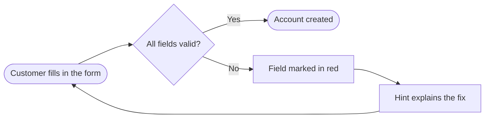

# Diagrams

Read when the format includes diagrams, or when a video needs a "how it works" scene.

## Choose 1–3

| Diagram | Use for |
|---|---|
| `flowchart` (LR or TD) | the user's path through a feature, decisions and outcomes |
| `sequenceDiagram` | what happens behind the scenes between the user, the product and outside services |
| `stateDiagram-v2` | a status lifecycle: order, ticket, invoice, approval |
| `journey` | before vs after experience, scored steps |
| `timeline` | rollout phases, what ships when (only dates the user gave you) |
| `erDiagram` | data model; only with `audience=technical` |

## Write

- Labels in the customer's language, 2–5 words each, sentence case. No code identifiers, table names, endpoints or library names.
- 4–9 nodes per diagram. Split rather than crowd.
- Quote labels with punctuation: `A["Payment received?"]`. Line breaks: `<br>`.
- Sequence participants are roles the customer recognises: `Customer`, `Your shop`, `Payment provider`.
- Decisions as `{…}`, start and end as stadium `([…])`.
- Leave theming to the config: no `%%{init}%%`, no `classDef` colours, no `style` lines.

Save each as `SRC/diagrams/<name>.mmd`, with `<name>` in kebab-case ASCII (it becomes the file name the customer sees).



## Render

```
node "${CLAUDE_SKILL_DIR}/scripts/render-diagrams.mjs" --src SRC
```

- Uses `SRC/mermaid-config.json` from theme.mjs: `theme: "base"`, hex-only `themeVariables` mapped from the style, and the style's look (`neo` for Modern SaaS, `handDrawn` for whiteboard, `classic` for the rest).
- Fonts load through `SRC/fonts/mermaid.css` and are embedded into the SVG with their licence, so the SVG renders correctly anywhere and never falls back to a default serif.
- Outputs: `diagrams/<name>.svg` (transparent), `diagrams/<name>.png` (scale 2, style background), and `SRC/diagrams/<name>.scene.png` (transparent, for scenes).
- A syntax error fails only that diagram; the JSON carries the parser message and line. Fix the `.mmd` and run again, `--only <name>` for just that one.

## In the video and stills

Add a `diagram` scene with `assets: ["diagrams/<name>.scene.png"]` and render diagrams before stills and video. Wide flowcharts (LR) fit 16:9 scenes best; keep tall ones to 5 rows.

## Deliver

The customer gets the SVG and PNG. The editable `.mmd` sources stay in `SRC/diagrams/`; mention them when the user might want to edit a diagram later; any Mermaid editor opens them.
